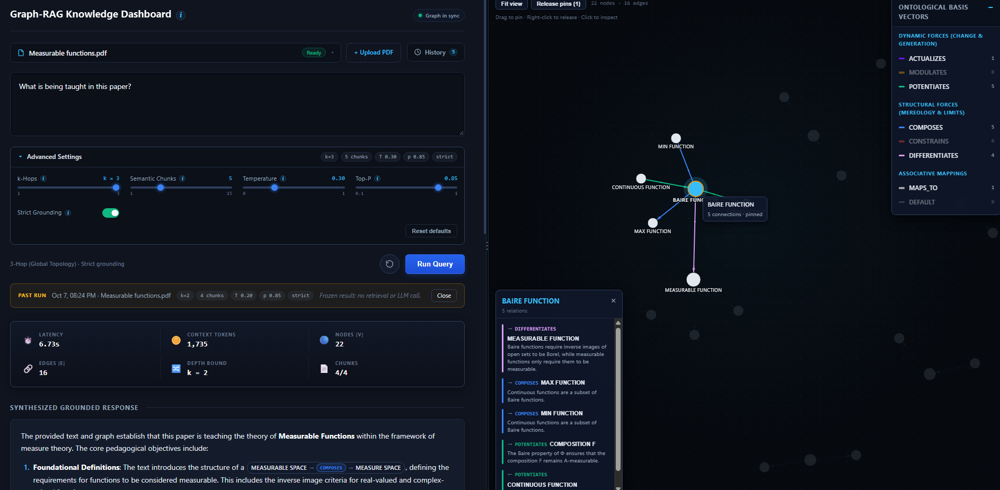
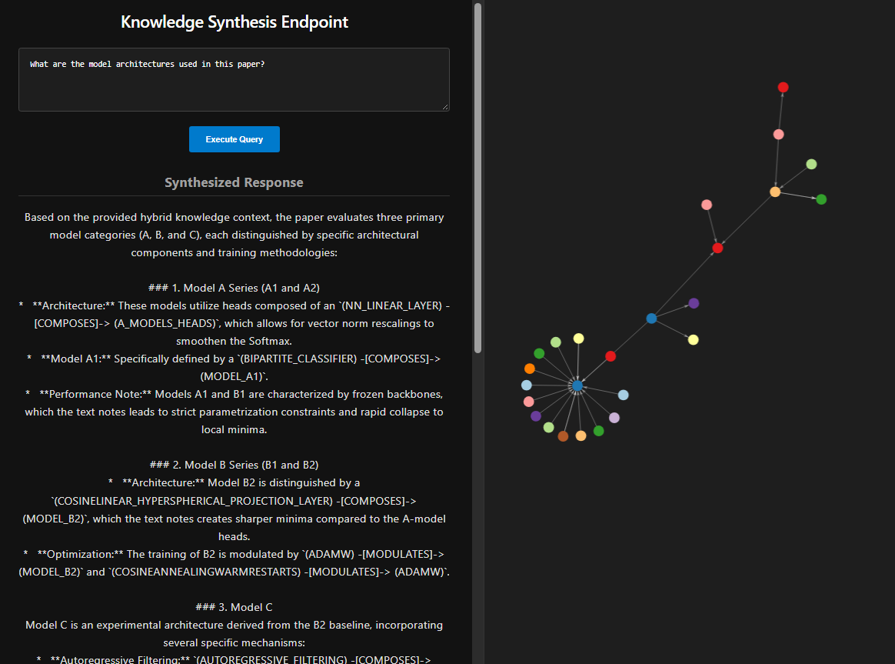
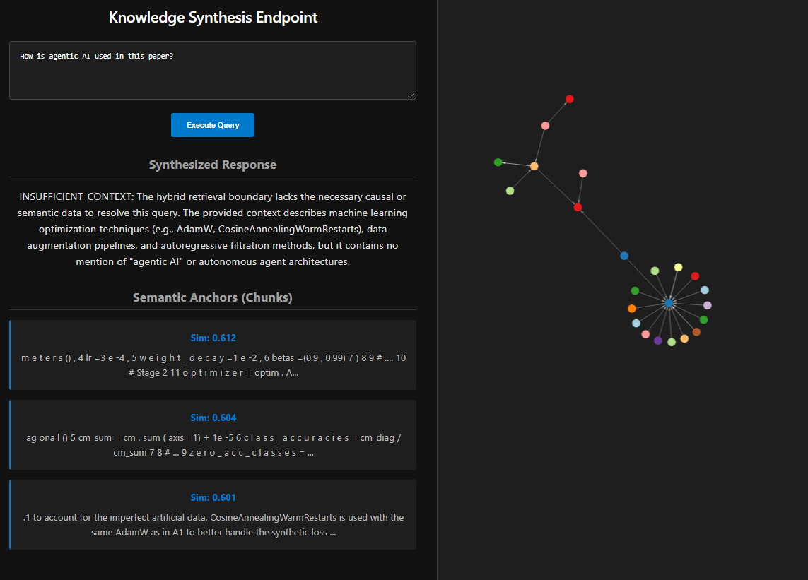
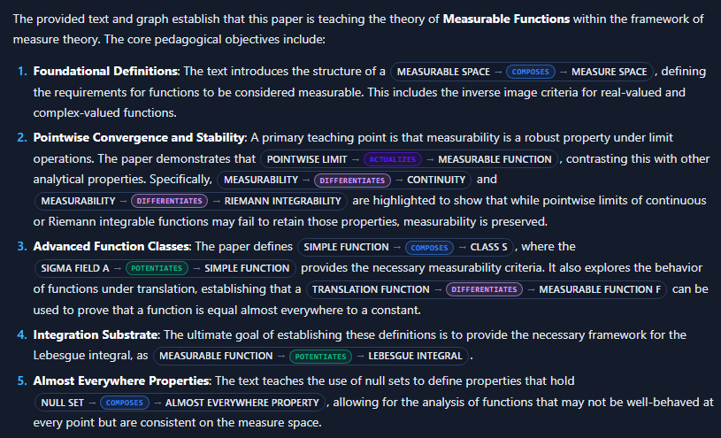
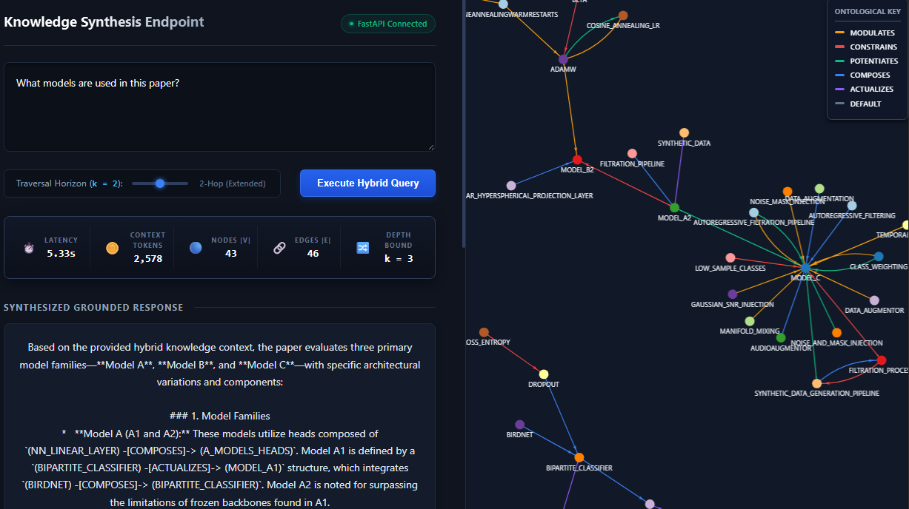
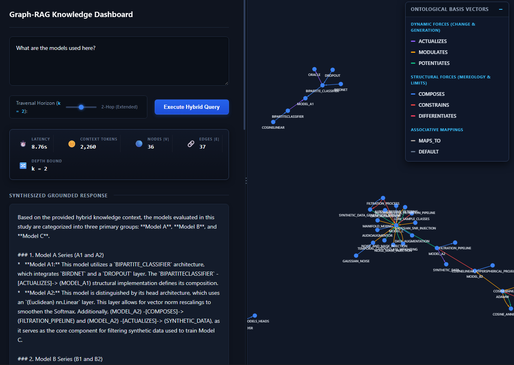

# Graph-RAG Knowledge Dashboard (Project 576)

A full-stack **Hybrid Graph-RAG (Retrieval-Augmented Generation)** web application engineered to solve the multi-hop reasoning problem and eliminate LLM hallucinations. The project's philosophy aims to challenge forefront projects in the industry which use domain-specific ontologies, with this project instead opting for semantic primitives found in human language, alongside a "concept rubrik" for the LLM to correctly interpret and abstract the semantic primitives, thus surpassing the need for local-dependence. The system pairs continuous 768-dimensional vector search in **Supabase PostgreSQL (`pgvector`)** with discrete topological traversal in **Neo4j AuraDB**, governed by a closed cognitive ontology of **7 Leonard Talmy Force Dynamics primitives** ($\Theta$).

---

## Screenshots

> **Full project report** (architecture, formal retrieval model, testing, security matrix, 108-run benchmark vs. TrustGraph, engineering challenges): [`docs/GraphRAG_report.pdf`](docs/GraphRAG_report.pdf)


*Week 10 dashboard. Left: document bar, query console, advanced settings, telemetry ribbon and the grounded answer. Right: interactive force-directed causal graph with node inspector and the 7 Talmy ontology filters.*

<table>
  <tr>
    <td width="50%"></td>
    <td width="50%"></td>
  </tr>
  <tr>
    <td><em>In-scope question: a synthesized multi-hop answer with its causal subgraph.</em></td>
    <td><em>Strict grounding: an out-of-scope question is refused with <code>INSUFFICIENT_CONTEXT</code> rather than hallucinated, and the retrieved source chunks are shown with their cosine similarity.</em></td>
  </tr>
</table>


*Inline <code>(SOURCE) -[RELATION]-> (TARGET)</code> citations rendered as clickable, colour-coded ontology badges.*

<table>
  <tr>
    <td width="50%"></td>
    <td width="50%"></td>
  </tr>
  <tr>
    <td><em>Earlier build: live telemetry (latency, context tokens, nodes, edges, depth bound) beside the traversed subgraph.</em></td>
    <td><em>The 7 closed-class Force Dynamics primitives, used as the graph's edge types and as a canvas filter.</em></td>
  </tr>
</table>

---

## 1. Quickstart (Out-of-the-Box Local Execution)

All active runtime functionality is launched via two commands:

### Step 1: Start the FastAPI Backend (`http://127.0.0.1:8000`)
```powershell
cd C:\project-576 #example path
.\.venv\Scripts\Activate.ps1
pip install -r requirements.txt
python server_api\main.py
```
*On startup, the backend initializes `HybridQueryEngine`, verifies L0/L1 synchronization between the Supabase `extracted_graph` JSONB cache and the Neo4j graph projection (repairing any drift in 0 LLM tokens), and resumes any interrupted PDF ingestion jobs.*

### Step 2: Start the React + Vite Frontend (`http://localhost:5173`)
```powershell
cd C:\project-576\frontend
npm install #etc...
npm run dev
```
*Open **`http://localhost:5173`** in your browser to upload PDFs, tune retrieval/generation hyperparameters ($k$-hops, top-$\kappa$ semantic chunks, temperature, top-$p$, strict grounding), inspect interactive force-directed causal subgraphs, and replay frozen historical runs from the `History` drawer.*

---

## 2. Core Repository Architecture

Only modules essential to the active full-stack workflow are kept in the root workspace (one-off diagnostic probes and legacy prototypes are isolated in `_archive/`):

| Directory / Module | Single-Responsibility Role |
| :--- | :--- |
| `server_api/main.py` | FastAPI application entrypoint, Pydantic request/response schemas, and REST routes (`POST /api/upload`, `GET/DELETE /api/documents`, `POST /api/query`, `GET/DELETE /api/runs`, `GET/POST /api/graph/sync`). |
| `retrieval/query_engine.py` | `HybridQueryEngine`: embeds queries (`RETRIEVAL_QUERY`, 768-d), runs `pgvector` HNSW cosine search, executes bounded undirected $k$-hop BFS + intent-focus expansion in Neo4j, assembles the Gestalt prompt, and synthesizes grounded responses. |
| `pipeline/jobs.py` | Semaphore-bounded, resumable background ingestion worker (`queued -> store -> parse -> embed -> extract -> finalize`). |
| `pipeline/ingest.py` | Deterministic `pypdf` text extraction, 1000/200 character sliding-window chunking, SHA-256 document identity, and Supabase Blob Storage integration. |
| `pipeline/sync_embeddings.py` | Idempotent 768-d `gemini-embedding-001` (`RETRIEVAL_DOCUMENT`) batch vector projection into PostgreSQL `document_chunks`. |
| `pipeline/assemble_graph.py` | Concurrent 4-chunk batched structured JSON extraction under the Talmy Force Dynamics system prompt, cached in `document_chunks.extracted_graph` (JSONB) with `ontology_hash`. |
| `pipeline/graph_sync.py` | `GraphSyncManager`: cryptographic cache-to-Neo4j synchronization check (`L0`), automatic zero-token Neo4j projection repair (`L1`), orphan purging, and explicit stale-cache LLM re-extraction (`L2`). |
| `ontologies/hybrid_semantic_partition.py` | Defines the 7 closed-class Talmy Force Dynamics primitives (`ACTUALIZES`, `MODULATES`, `POTENTIATES`, `COMPOSES`, `CONSTRAINS`, `DIFFERENTIATES`, `MAPS_TO`) and the Contrast Rule. |
| `database/` | Connection factories (`database.py`), Neo4j constraint initializer (`init_neo4j_schema.py`), system reset utility (`reset_system.py`), and one-time SQL migrations (`migrations/001_multidoc.sql`, `002_query_runs.sql`). |
| `frontend/` | React 19 + Vite split-pane interface (`App.jsx`, `CausalGraph.jsx`, `MarkdownAnswer.jsx`, `DocumentPicker.jsx`, `AdvancedSettings.jsx`, `GraphSyncBadge.jsx`, `RunTimeline.jsx`). |
| `run_pipeline.py` | Optional CLI orchestrator for headless PDF ingestion and database resets. |
| `tests/test_multidoc_pipeline.py` | Pure-logic unit test suite (`pytest`) covering SHA-256 identity, graph drift hashing, sliding-window chunk termination, and filename sanitization. |

---

## 3. Environment Configuration (`.env`)

Create a `.env` file in the project root (see [`env-specs.md`](./env-specs.md) for further details):

```ini
DATABASE_URL=postgresql://...          # Supabase Transaction Pooler URI (Port 6543)
SUPABASE_URL=https://<project>.supabase.co
SUPABASE_SERVICE_ROLE_KEY=...          # Required for private PDF bucket storage
NEO4J_URI=neo4j+s://<id>.databases.neo4j.io
NEO4J_USERNAME=neo4j
NEO4J_PASSWORD=...
GEMINI_API_KEY=...                     # Google AI Studio API Key
GEMINI_EMBEDDING_MODEL=gemini-embedding-001
GEMINI_EXTRACTION_MODEL=gemini-3.1-flash-lite
GEMINI_SYNTHESIS_MODEL=gemini-3.1-flash-lite
```

---

## 4. Verification & Maintenance Commands

```powershell
# Run automated unit tests (no network/DB required)
python -m pytest tests/test_multidoc_pipeline.py -v

# Verify database connectivity (PostgreSQL + Neo4j AuraDB)
python -m database.database

# Apply one-time PostgreSQL schema migrations on a fresh Supabase instance
python -m database.apply_migrations --yes 001 002

# Build production React frontend bundle
npm --prefix frontend run build
```

